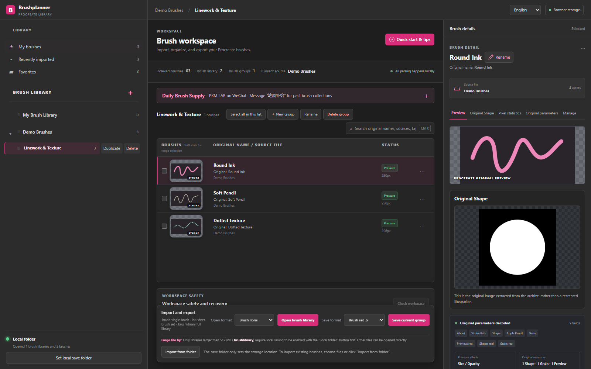

# Brushplanner

**Your Procreate brushes, easier to find and organize.**

[**Open Brushplanner ↗**](https://brushplanner.cc/) · [中文说明](README.zh-CN.md) · [User guide](https://brushplanner.cc/guide)

Brushplanner is a browser-based manager for your Procreate brush collection. Import your own brushes, inspect their original previews, organize libraries and groups, and export what you need. No sign-in required.

*Screenshot uses synthetic demo brushes to demonstrate the interface.*

## What you can do

- **Bring your brushes together.** Import `.brush` and `.brushset` files, or restore a Brushplanner `.brushlibrary` snapshot.
- **See what is inside.** View embedded brush previews, original Shape images, and Grain textures when the files contain them. Missing resources are identified instead of replaced with invented brush strokes.
- **Organize your collection.** Create libraries and nested groups; search, favorite, select multiple brushes, move, copy, reorder, and rename.
- **Keep the original name.** Brushes retain their imported names until you choose to rename them. Your display name is stored separately from the original name and original brush data.
- **Delete with a way back.** Move brushes to the trash, restore them, or explicitly delete them permanently.
- **Export and back up.** Export individual brushes, brush sets, or a `.brushlibrary` snapshot of a selected library and its groups.
- **Use Chinese or English.** Switch the interface language and follow the guided tour through the actual controls.

## Get started in four steps

1. **Choose where to save.** Open [brushplanner.cc](https://brushplanner.cc/) and choose a local folder if your browser supports it. Browser local storage is also available.
2. **Import your brushes.** Use the import control to select `.brush`, `.brushset`, or `.brushlibrary` files. Selecting a save folder does not automatically import loose brush files from it.
3. **Make it your library.** Create groups, select brushes to organize them, and open a brush to inspect its details. Use the pencil beside its name if you want to rename it.
4. **Export what you need.** Select the relevant brush, group, or library, then choose an export option. Use `.brushlibrary` to move a Brushplanner library to another browser or device.

For a walkthrough, use **Quick start & tips** in the workspace or read the [full guide](https://brushplanner.cc/guide).

## Browsers and local saving

The latest desktop **Edge or Chrome** is recommended for choosing a normal folder on Windows or macOS. Safari and browsers without that folder interface use browser-managed local storage when available; exports go to the browser's download location. This storage is not a normal Finder or Explorer folder.

Brush parsing, previews, organization, and export run in your browser without uploading your brush files to a Brushplanner server. See the [privacy policy](https://brushplanner.cc/privacy) for the website's wider data practices.

Keep a separate backup: clearing site data, using private browsing, or switching browsers can affect browser-stored libraries. A `.brushlibrary` snapshot contains the selected library, not every library or the trash. It is a **Brushplanner backup format**, not a Procreate import format; use `.brush` or `.brushset` for Procreate.

## Feedback

Found a problem or have an idea? Open an issue using the templates in this repository. Please include your browser, operating system, and steps to reproduce a problem. Redact private information from screenshots, and do not upload paid or private brush packs.

## About this repository

This is Brushplanner's public product and feedback page. It contains documentation and screenshots only; **the application's source code is not included or open-sourced here**. Use the hosted application at [brushplanner.cc](https://brushplanner.cc/).

Brushplanner is an independent tool and is not affiliated with Procreate. Brush artwork and files remain subject to their creators' terms.
